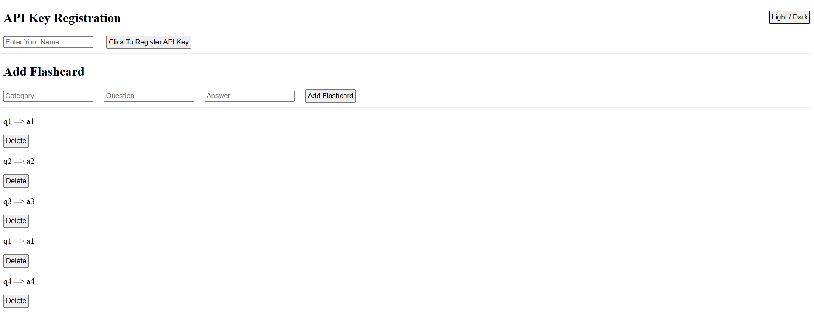

# Resolution Python Week 5
I created a front end for my flashcard api. You can create and delete your flashcards. You can also see the question and the answer to the flashcard. However you will need to register your API using the text entry and button at the top. You'll need to have an API key in order to create and delete flashcards. Also if you don't like the light mode, you can click the button on the top right to switch over to dark mode.

## Installation
In order to install the package you will need to run ```pip install -i https://test.pypi.org/simple/ resolution-week5-Asurant``` in your CLI  
You have an installation issue involving packages, use this command:  
```pip install --index-url https://test.pypi.org/simple/ --extra-index-url https://pypi.org/simple/ resolution-week5-Asurant```  

## Running The Project
After you install the package you can start the API using:  
```python -m uvicorn resolution_week5_Asurant.main:app --reload```  
The API will run locally and view the front end at:  
```http://127.0.0.1:8000```  
You can access the API documentation and use it at:  
```http://127.0.0.1:8000/docs```

## API Endpoints
| Request | Endpoint | Description |
|---|---|---|
| GET | /flashcards | Gets All Flashcards |
| GET | /secret-data | Tests the API Key Authentication |
| POST | /register | Registers A New User And Makes A New API Key |
| POST | /flashcards | Creates A New Flashcard |
| DELETE | /flashcards/{flashcard_id} | Deletes A Flashcard Based On ID |


